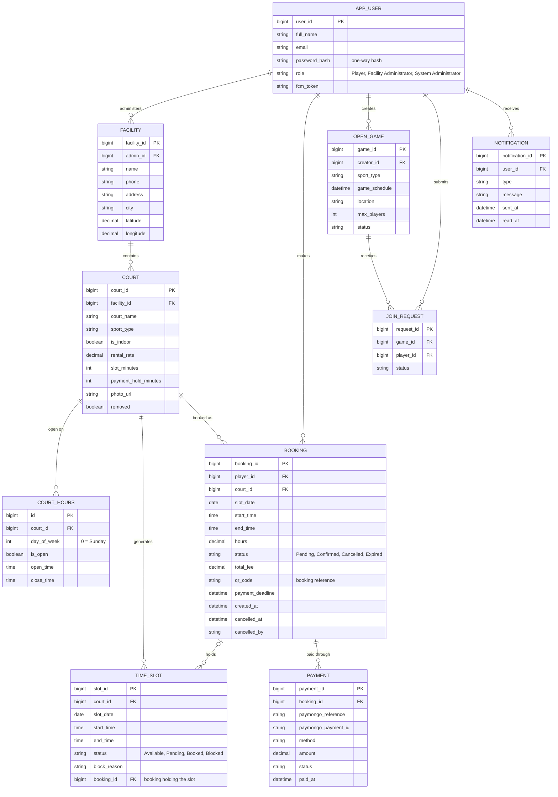

# CourtConnect ERD

Paste the code below into https://mermaid.live to view or export it as PNG/SVG.
Implemented so far: `app_user`, `password_reset_token` (Increment 2), and `facility`, `court`, `court_hours`, `time_slot`, `booking`, `payment`, `notification` (Increment 3, see `docs/sql/increment-3.sql`). `OPEN_GAME` and `JOIN_REQUEST` come with Find Players.

