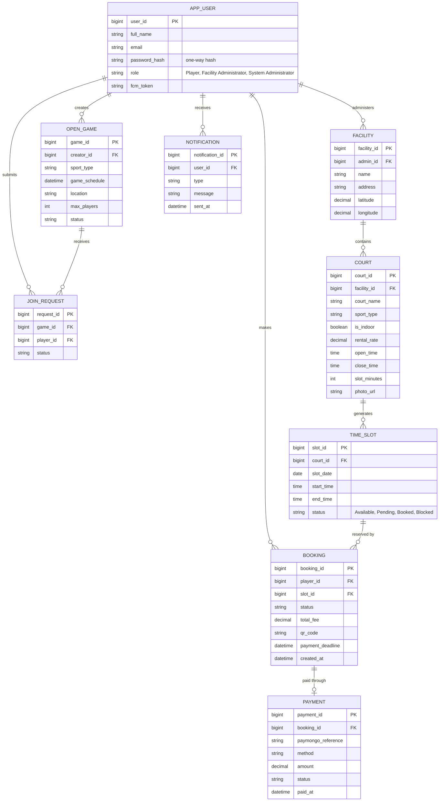

# CourtConnect ERD

Paste the code below into https://mermaid.live to view or export it as PNG/SVG.
`APP_USER` (table `app_user`) is already implemented in the backend. The other tables are added as each feature is built.

